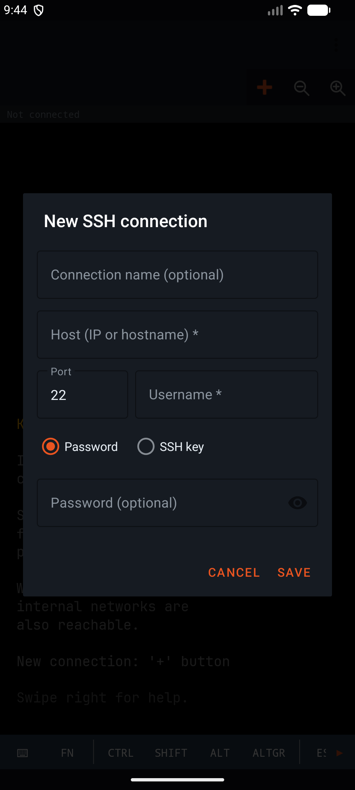
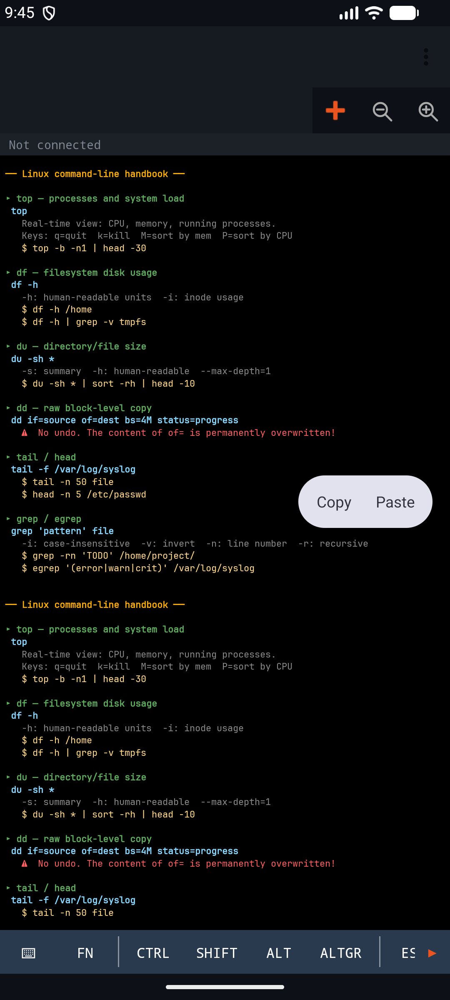

# KonsoleSSH

SSH-Terminal mit mehreren Tabs für Android, nach dem Vorbild von KDE Konsole.

> **Sprache:** Deutsch · [English](README.md) · [Magyar](README.hu.md) · [Español](README.es.md) · [Français](README.fr.md) · [Slovenčina](README.sk.md) · [Română](README.ro.md)

## Screenshots

| Startseite | Neue SSH-Verbindung |
| --- | --- |
|  |  |

| Tmux-Spickzettel | Linux-Spickzettel |
| --- | --- |
|  |  |

## Funktionen

**Tabs**
- Beliebig viele SSH-Sitzungen nebeneinander, jede in einem eigenen Tab; Wechsel per Wischen oder über die Tableiste.
- Statuspunkt auf jedem Tab: verbindet, verbunden, getrennt; ein getrennter Tab bietet eine Schaltfläche zum erneuten Verbinden.
- Langes Drücken benennt einen Tab um; vor dem Schließen eines verbundenen Tabs fragt die App nach.
- Zuerst kommt die Startseite; nach dem letzten Tab folgen ein Linux- und ein tmux-Spickzettel.

**Verbindungen**
- Gespeicherte Verbindungen als Baum: Namen mit gemeinsamem Präfix bis zum Unterstrich (`acme_prod_web`, `acme_prod_db`) werden gruppiert.
- Anmeldung per Passwort oder privatem Schlüssel, einschließlich keyboard-interactive. Ein nicht gespeichertes Passwort wird beim Verbinden abgefragt.
- Jump-Hosts, auch verkettet: ein Jump-Host kann selbst einen Jump-Host haben, bis zu 5 Stufen. Bei einer privaten Adresse schlägt das Formular einen vor.
- Verbindungstest sowie Erzeugen eines RSA-Schlüssels und Hochladen des öffentlichen Teils in die `authorized_keys` des Servers.
- Host-Key-Prüfung nach dem Prinzip „Trust on first use“: beim ersten Verbinden wird der SHA256-Fingerabdruck angezeigt, ein geänderter Schlüssel wird nur nach ausdrücklichem Ersetzen akzeptiert.

**Terminal**
- xterm-kompatible Emulation: 16, 256 und True Color, alternativer Bildschirm, Scrollbereich, Bracketed Paste, Anwendungs-Cursortasten, DEC-Liniengrafik, breite CJK- und Emoji-Zeichen. Abgeglichen mit tmux anhand aufgezeichneter bash-, vim-, less-, htop- und mc-Sitzungen.
- 3000 Zeilen Scrollback; Textauswahl mit Kopieren und Einfügen; Zoom mit den Schaltflächen in der Tableiste, bleibt nach einem Neustart erhalten.
- Hardware-Tastaturen funktionieren, einschließlich Funktionstasten, Pos1/Ende, Bild auf/ab und Umschalt+Bild auf/ab für den Scrollback.

**Tastenleiste**
- Einrastende Strg-, Umschalt-, Alt- und AltGr-Tasten: ein Modifikator wirkt auf die nächste Taste und löst sich dann.
- Esc, Tab, eine Funktionstastenzeile (F1–F12), eine Pfeiltastenzeile und eine Strg-Zeile (Strg+A…Z; Strg+C kopiert eine Auswahl, sonst unterbricht es).
- Lädt eine Datei per SFTP ins entfernte Home-Verzeichnis hoch, mit Fortschrittsanzeige und für einige Sekunden rückgängig zu machen.

**Sonstiges**
- Sitzungen laufen im Hintergrund weiter, hinter einer Benachrichtigung, die die aktiven Verbindungen zählt.
- Nach einem Absturz oder ANR bietet die App einen Fehlerbericht zum Teilen an; nichts wird automatisch gesendet.
- Sieben Sprachen: Englisch, Ungarisch, Deutsch, Spanisch, Französisch, Slowakisch, Rumänisch; auch in der App wählbar.

## Architektur

- **Oberfläche:** Jetpack Compose mit Material 3, eine Activity pro Bildschirm (Hauptbildschirm, gespeicherte Verbindungen).
  Das Terminal selbst ist eine auf Canvas zeichnende View (`TerminalView`), in Compose eingebettet.
- **Zustand:** ein einziger `SessionManager`, der so lange lebt wie die App, besitzt die Tabs, ihre Sitzungen,
  die Ausgabe und offene Rückfragen. Die Oberfläche beobachtet seinen Zustand über ViewModels und sendet Befehle;
  eine Passwort- oder Host-Key-Frage ist Zustand und übersteht daher eine Drehung.
- **Hintergrund:** `SshForegroundService` hält nur den Prozess am Leben und zeigt die Benachrichtigung;
  er läuft, solange ein Tab verbindet oder verbunden ist, und beendet sich danach selbst.
- **Speicherung:** Verbindungen in einer mit AES-256-GCM verschlüsselten DataStore-Datei (Android-Keystore-Schlüssel,
  von der Sicherung ausgenommen); Einstellungen in DataStore Preferences; Host-Keys in einer `known_hosts`-Datei
  im OpenSSH-Stil. Ein unlesbarer Speicher wird gemeldet, nie überschrieben.
- **Terminalmodell:** `TerminalBuffer` ist reines Kotlin ohne Android-Abhängigkeiten und wird daher auf der JVM getestet.
- **Abhängigkeiten** werden in `AppContainer` von Hand verdrahtet, ohne DI-Framework.

## Projektstruktur

```
app/src/main/java/hu/billman/konsolessh/
  model/        ConnectionConfig: die gespeicherte Verbindung
  data/         verschlüsselter Verbindungsspeicher, Einstellungen, Migration älterer Formate
  ssh/          JSch-Sitzungen, Jump-Kette, Host-Key-Prüfung, Schlüssel-Upload, typisierte Fehler
  session/      SessionManager, Ausgabepuffer, Passwort- und Host-Key-Fragen
  terminal/     TerminalView und TerminalBuffer: Darstellung, Eingabe, Emulation
  service/      der Vordergrunddienst
  diagnostics/  Absturz- und ANR-Berichte
  ui/           Compose-Bildschirme, ViewModels, Tastenleiste, Theme
  AppContainer.kt  der Abhängigkeitsgraph
```

## Build

```
Kotlin 2.4 · AGP 9.5 · Gradle 9.6 · Java 17
minSdk 26 (Android 8.0) · targetSdk / compileSdk 37 (Android 17)
```

```bash
./gradlew detekt :app:testDebugUnitTest :app:lintDebug   # Prüfungen und Unit-Tests
./gradlew :app:connectedDebugAndroidTest                 # UI-Tests auf Gerät oder Emulator
./gradlew :app:bundleRelease                             # signiertes App Bundle (braucht einen Keystore)
```

Die Unit-Tests enthalten Integrationstests gegen echte OpenSSH-Server; sie brauchen ein installiertes
`sshd` und werden ohne es übersprungen. Der Release-Build wird mit R8 minimiert.

## Bedienung

1. **Neue Verbindung:** `+` → *Neue Verbindung…*, dann Host, Port, Benutzername und Passwort oder Schlüssel.
2. **Jump-Host:** im Formular *Jump-Host einrichten…* öffnen und eine gespeicherte Verbindung als Gateway wählen.
3. **Tab umbenennen oder schließen:** lange drücken bzw. auf `✕` tippen.
4. **Zoom:** die Lupen-Schaltflächen neben `+`.
5. **Spickzettel:** über den letzten Tab hinaus wischen.
6. **Datei hochladen:** 📁 in der Tastenleiste; die Datei landet im entfernten Home-Verzeichnis (`~`).
7. **Beenden:** Menü (⋮) → *Beenden* oder `+` → *Beenden*.

## Abhängigkeiten

| Bibliothek | Zweck |
| --- | --- |
| JSch (mwiede-Fork) | SSH und SFTP |
| Bouncy Castle | Ed25519-Host-Keys und curve25519-Schlüsselaustausch für JSch |
| Jetpack Compose, Material 3 | Oberfläche |
| AndroidX Lifecycle, Activity | ViewModels, lebenszyklusbewusster Zustand |
| kotlinx.coroutines | asynchrone SSH-Ein-/Ausgabe |
| kotlinx.serialization | Format des Verbindungsspeichers |
| AndroidX DataStore | Verbindungsspeicher und Einstellungen |
| AndroidX AppCompat | Sprachwahl in der App unter Android 8–12 |
| androidx.security | nur zur Migration von Speichern aus der Zeit vor 1.1.12 |

Die genauen Versionen stehen in `gradle/libs.versions.toml`.

## Berechtigungen

| Berechtigung | Grund |
| --- | --- |
| `INTERNET` | SSH-Verbindungen |
| `ACCESS_NETWORK_STATE` | Erreichbarkeit prüfen |
| `FOREGROUND_SERVICE`, `FOREGROUND_SERVICE_SPECIAL_USE` | offene Sitzungen im Hintergrund am Leben halten (API 34+) |
| `POST_NOTIFICATIONS` | die Sitzungsbenachrichtigung (API 33+) |
| `ACCESS_LOCAL_NETWORK` | Hosts im lokalen Netzwerk (Android 17+) |

Es werden keine Daten erhoben oder irgendwohin gesendet. Zugangsdaten bleiben verschlüsselt auf dem Gerät.

## Lizenz

GPL-3.0-or-later; siehe [LICENSE](LICENSE).

## Versionsgeschichte

- **2.1.0** — nach dem Schließen des letzten Tabs erscheint wieder die
  Startseite statt eines Spickzettels; eine per langem Druck begonnene Auswahl
  bleibt erhalten, wenn der Finger ohne Ziehen losgelassen wird; bei großer
  Systemschrift folgt das Terminal der nichtlinearen Skalierung von Android 14;
  Texte mit Anzahl verwenden in jeder Sprache die richtige Einzahl und Mehrzahl;
  der Bildschirm folgt der Rotationssperre des Systems; in vorausgefüllten
  Formularfeldern wird am Ende weitergeschrieben; das Tippen auf das Terminal
  ist für Bedienungshilfen erreichbar
- **2.0.0** — ein neues Speicherformat und eine neu gebaute Oberfläche.
  Gespeicherte Verbindungen ziehen in eine verschlüsselte DataStore-Datei,
  Einstellungen in DataStore; das Update migriert sie einmal und entfernt die
  alten Dateien, sodass 1.x sie danach nicht mehr lesen kann. Alle Bildschirme
  sind mit Jetpack Compose und Material 3 neu gebaut. Ein Datei-Upload läuft
  bei einer Drehung weiter; der Jump-Host-Vorschlag erkennt private Adressen an
  ihren tatsächlichen Bereichen; das Wischen zwischen Tabs funktioniert auch
  über dem Terminal. Der Hintergrunddienst nutzt den Vordergrunddienst-Typ
  `specialUse`. Das Menü verlinkt die Datenschutzerklärung
- **1.1.30** — testgetriebene Qualitätsarbeit. Terminal: Vergleich mit tmux an
  aufgezeichneten bash-, vim-, less-, htop- und mc-Sitzungen; behoben wurden
  CSI-Sequenzen mit Zwischenbyte (vims Cursorform gab ein verirrtes `q` aus),
  Hintergrundfarbe beim Löschen (mcs farbige Panels), VPA/HPA/REP und Tabulator mit
  Anzahl (htop war um eine Zeile verschoben), xterm-Alternativbildschirm-Modi, der
  Hauptbildschirm hinter vim bei Drehung, SGR dim/kursiv/durchgestrichen sowie
  riesige Wiederholungszahlen, die den Parser blockieren konnten. SSH: ein während
  des Verbindens geschlossener Tab hinterlässt keine halboffene Verbindung mehr (bis
  zu 2 Minuten); eine beschädigte known_hosts-Zeile wird kein vertrauenswürdiger
  Schlüssel mehr. Integrationstests mit echtem sshd, Fehlerinjektion und
  Emulator-UI-Tests laufen in der CI, mit Abdeckungsmessung
- **1.1.29** — Terminalemulation: breite Zeichen (CJK, Emoji) belegen wie auf dem
  Server zwei Zellen, kombinierende Zeichen hängen an der vorigen Zelle,
  DEC-Liniengrafik (`ESC ( 0`) für ncurses-/dialog-/mc-Rahmen, Cursorpositions- und
  Geräteabfragen (`CSI 6n`, DA) werden beantwortet — beim Wiedergeben nach einer
  Drehung aber nicht erneut; Text wird in Läufen statt zellenweise gezeichnet.
  Fehlerberichte: nach einem ANR oder Absturz bietet die App das Teilen eines
  Berichts an (Version, Gerät, Trace — ohne Geheimnisse); nichts wird automatisch
  gesendet. Der Vordergrunddienst läuft nur bei aktiver Sitzung. Schlüsseldateien
  werden außerhalb des Hauptthreads gelesen. Behoben: Spickzettel erschienen nach
  einer Größenänderung doppelt
- **1.1.28** — die Terminalausgabe wird in einem Hintergrundthread in Abschnitten
  verarbeitet, große Ausgaben (`cat` einer großen Logdatei, `find /`) blockieren die
  Oberfläche nicht mehr; an Lesegrenzen geteilte UTF-8-Zeichen bleiben intakt
- **1.1.27** — geschichtete Architektur nach einem Code-Audit: ein Sitzungsmanager
  als einzige Quelle der Wahrheit, Rückfragen kommen als Zustand und überstehen das
  Drehen, typisierte Fehler mit einem Text-Mapper; ein unlesbarer
  Verbindungsspeicher wird nicht mehr überschrieben, und nichts wird unverschlüsselt
  gespeichert; keine Geheimnisse mehr in Fragment-Argumenten; beim Bearbeiten bleibt
  die Schlüssel-Passphrase erhalten; sichererer Upload-Befehl für Schlüssel
- **1.1.26** — Prüfung des Server-Host-Keys (Trust on First Use,
  SHA256-Fingerabdruck, Warnung bei Änderung); mehrstufige Jump-Hosts (ein Jump-Host
  kann selbst einen Jump-Host haben, bis zu 5 Sprünge), auch für Verbindungstest und
  Schlüssel-Upload; Ed25519-Host-Keys und curve25519-Schlüsseltausch über Bouncy
  Castle; verschlüsselte Profile vom Backup ausgenommen; aus dem Terminal kopierter
  Text als vertraulich markiert; kein überflüssiges „r“ mehr in Terminalmeldungen
- **1.1.25** — Ziel Android 17 (API 37): Berechtigung für lokales Netzwerk,
  vorausschauende Zurück-Geste, AGP 9.5 / Gradle 9.6
- **1.1.24** — Verbindungstest funktioniert auch mit privatem Schlüssel
- **1.1.23** — App-Logo und Titel „KonsoleSSH“ in der Toolbar
- **1.1.22** — Menüpunkt „Beenden“ am Ende des Überlaufmenüs
- **1.1.21** — statische Analyse (detekt, ktlint) und CI-Qualitätsprüfung,
  Dependabot, OSV-Scanner
- **1.1.20** — Aufräumen: Node.js 24 in der CI, Sprachkonfiguration
- **1.1.19** — Abhängigkeits-Updates (security-crypto stabil)
- **1.1.18** — CI, Entfernen toten Codes, Lifecycle- und Lint-Korrekturen
- **1.1.17** — SSH-Keep-alive; Systemmeldungen erscheinen nicht mehr unter dem
  Prompt
- **1.1.16** — Fehlerbehebung: Absturz beim Drehen (Race im Fragment-Lifecycle)
- **1.1.15** — Sitzungen und Dialoge überstehen das Drehen
- **1.1.14** — MVVM-Schicht (ViewModels)
- **1.1.13** — Entf-Taste (Vorwärtslöschen) über SSH
- **1.1.12** — eigene AES-256-GCM-Verschlüsselung (Android Keystore) mit atomarer
  Migration älterer Profile
- **1.1.11** — Versionszeile im Willkommensbanner
- **1.1.10** — Ereignisfluss zwischen Service und Oberfläche (Kotlin Flow)
- **1.1.4–1.1.9** — internes Refactoring (Terminalpuffer, Verbindungs-Repository,
  Schlüsselgenerator), Abhängigkeits-Updates, Lint-Korrekturen
- **1.1.3** — Verbindungsfehler als Toast; der Tab schließt sich nach 5 s
  automatisch
- **1.1.2** — eigene Meldungen für drei Arten von Verbindungsfehlern
- **1.1.1** — Schlüssel-Upload erst nach erfolgreichem Test; der öffentliche
  Schlüssel wird per Passwort-Anmeldung hochgeladen
- **1.1.0** — integrierter SSH-Schlüsselgenerator
- **1.0.9** — Authentifizierungsreihenfolge publickey zuerst, Erklärung für „Auth
  cancel“
- **1.0.8** — Sprachauswahl im Überlaufmenü
- **1.0.7** — GPL-3.0-Lizenz hinzugefügt, F-Droid-kompatibler Build (bedingte Signing-Konfiguration)
- **1.0.6** — Reconnect-Statusanzeige wird nun korrekt grün (bleibt nicht mehr
  auf Gelb hängen); Tastatur-Symbol öffnet die IME zuverlässig auf Android 14+
  (echte `WindowInsetsCompat`-basierte Sichtbarkeit statt des veralteten `SHOW_FORCED`)
- **1.0.5** — interner Fix (übersprungene Version)
- **1.0.4** — neues, schlankeres `>_` Prompt-App-Icon (Stroke-Design)
- **1.0.3** — für Play verfeinertes App-Icon und Assets
- **1.0.2** — Paket umbenannt in `hu.billman.konsolessh`, Edge-to-Edge-Insets-Fix,
  Softtastatur nur auf ausdrückliche Anforderung, SFTP-Upload mit Fortschrittsdialog
  und Rückgängig-Toast, R8-Minifizierung, Gradle 9.4.1 / AGP 9.2.0
- **1.0.1** — `targetSdk = 35`, erste Play-Einreichung
- **1.0.0** — Multi-Tab-SSH, Jump-Host, Baum der gespeicherten Verbindungen,
  Linux- und Tmux-Referenzen, ungarische Übersetzung
