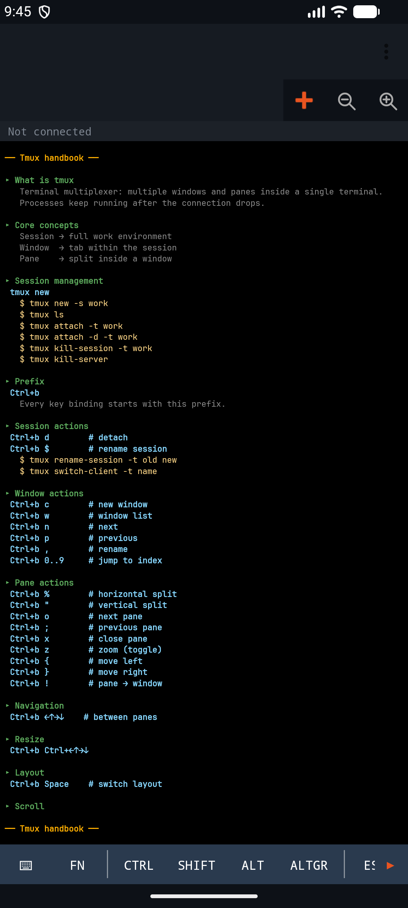

# KonsoleSSH

Terminal SSH con pestañas para Android, inspirado en KDE Konsole.

> **Idioma:** Español · [English](README.md) · [Magyar](README.hu.md) · [Deutsch](README.de.md) · [Français](README.fr.md) · [Slovenčina](README.sk.md) · [Română](README.ro.md)

## Capturas de pantalla

| Pantalla de bienvenida | Nueva conexión SSH |
| --- | --- |
|  |  |

| Chuleta de tmux | Chuleta de Linux |
| --- | --- |
|  |  |

## Funciones

**Pestañas**
- Tantas sesiones SSH como se quiera, cada una en su propia pestaña; se cambia deslizando o desde la barra de pestañas.
- Un punto de estado en cada pestaña: conectando, conectada o desconectada; una pestaña desconectada ofrece un botón para reconectar.
- Una pulsación larga renombra la pestaña; antes de cerrar una pestaña conectada la app pregunta.
- Primero va la página de bienvenida; tras la última pestaña siguen una chuleta de Linux y otra de tmux.

**Conexiones**
- Conexiones guardadas en árbol: los nombres que comparten prefijo hasta el guion bajo (`acme_prod_web`, `acme_prod_db`) se agrupan.
- Autenticación por contraseña o clave privada, incluidas las preguntas keyboard-interactive. Una contraseña no guardada se pide al conectar.
- Jump hosts, también encadenados: un jump host puede tener su propio jump host, hasta 5 saltos. Para una dirección privada el formulario propone uno.
- Prueba de conexión, y generación de una clave (Ed25519 si el servidor la acepta; si no, RSA) con subida de su mitad pública al `authorized_keys` del servidor.
- Verificación de host keys por confianza en el primer uso: en la primera conexión se muestra la huella SHA256, y una clave cambiada solo se acepta tras reemplazarla expresamente.

**Terminal**
- Emulación compatible con xterm: 16, 256 colores y color verdadero, pantalla alternativa, región de desplazamiento, bracketed paste, teclas de cursor de aplicación, dibujo de líneas DEC, caracteres anchos CJK y emoji. Comparada con tmux sobre sesiones grabadas de bash, vim, less, htop y mc.
- 3000 líneas de historial; selección de texto con copiar y pegar; zoom con los botones de la barra de pestañas, que se recuerda entre reinicios.
- Funcionan los teclados físicos, incluidas teclas de función, Inicio/Fin, RePág/AvPág y Mayús+RePág/AvPág para el historial.

**Barra de teclas**
- Ctrl, Mayús, Alt y AltGr fijables: un modificador se aplica a la siguiente tecla y luego se suelta.
- Esc, Tab, una fila de teclas de función (F1–F12), una fila de flechas y una fila Ctrl (Ctrl+A…Z; Ctrl+C copia una selección y, si no la hay, interrumpe).
- Sube un archivo por SFTP al directorio personal remoto, con progreso y la opción de deshacer durante unos segundos.

**Otros**
- Las sesiones siguen en segundo plano, tras una notificación que cuenta las conexiones activas.
- Siete idiomas: inglés, húngaro, alemán, español, francés, eslovaco y rumano; también se pueden elegir dentro de la app.
- Sincronización opcional con Google Drive: las conexiones guardadas (con contraseñas y claves) y las host keys aceptadas se sincronizan entre dispositivos a través de una carpeta oculta del propio Google Drive del usuario, cifradas de extremo a extremo con una frase que solo él conoce. Un dispositivo nuevo ofrece restaurarlas en el primer inicio.

## Arquitectura

- **Interfaz:** Jetpack Compose con Material 3 en una sola actividad; las pantallas (principal, conexiones guardadas, sincronización) son destinos de Navigation 3.
  El terminal en sí es una vista que dibuja sobre Canvas (`TerminalView`), integrada en Compose.
- **Estado:** un único `SessionManager`, que vive tanto como la aplicación, es dueño de las pestañas, sus sesiones,
  la salida y las preguntas pendientes. La interfaz observa su estado a través de ViewModels y envía órdenes;
  una pregunta de contraseña o de host key es estado, así que sobrevive a una rotación.
- **Segundo plano:** `SshForegroundService` solo mantiene vivo el proceso y muestra la notificación;
  funciona mientras alguna pestaña está conectando o conectada y después se detiene sola.
- **Almacenamiento:** conexiones en un archivo DataStore cifrado con AES-256-GCM (clave del Android Keystore,
  excluido de las copias de seguridad); ajustes en DataStore Preferences; host keys en un archivo `known_hosts`
  al estilo de OpenSSH. Un almacén ilegible se notifica y nunca se sobrescribe.
- **Modelo del terminal:** `TerminalBuffer` es Kotlin sin dependencias de Android, por lo que se prueba en la JVM.
- **Las dependencias** se conectan a mano en `AppContainer`, sin framework de inyección.
- **Sincronización** (opcional): `SyncManager` fusiona las conexiones y host keys del dispositivo con un archivo cifrado con AES-256-GCM en la carpeta oculta de datos de la app en Drive; la clave proviene de la frase del usuario (PBKDF2) y nunca sale de los dispositivos.

## Estructura del proyecto

```
app/src/main/java/hu/billman/konsolessh/
  model/        ConnectionConfig: la conexión guardada
  data/         almacén cifrado de conexiones, ajustes, borrado de almacenes antiguos
  ssh/          sesiones JSch, cadena de saltos, verificación de host keys, subida de claves, errores tipados
  session/      SessionManager, búfer de salida, preguntas de contraseña y host key
  sync/         sincronización con Google Drive: cifrado, fusión, cliente de Drive
  terminal/     TerminalView y TerminalBuffer: dibujo, entrada, emulación
  service/      el servicio en primer plano
  ui/           pantallas Compose, ViewModels, barra de teclas, tema
  AppContainer.kt  el grafo de dependencias
```

## Compilación

```
Kotlin 2.4 · AGP 9.5 · Gradle 9.6 · Java 17
minSdk 26 (Android 8.0) · targetSdk / compileSdk 37 (Android 17)
```

```bash
./gradlew detekt :app:testDebugUnitTest :app:lintDebug   # comprobaciones y pruebas unitarias
./gradlew :app:connectedDebugAndroidTest                 # pruebas de interfaz en dispositivo o emulador
./gradlew :app:bundleRelease                             # App Bundle firmado (requiere un keystore)
```

Las pruebas unitarias incluyen pruebas de integración contra servidores OpenSSH reales; necesitan `sshd`
instalado y se omiten si falta. La compilación release se minimiza con R8.

## Uso

1. **Nueva conexión:** `+` → *Nueva conexión…*, e introducir host, puerto, usuario y contraseña o clave.
2. **Jump host:** en el formulario, *Configurar jump host…* y elegir una conexión guardada como pasarela.
3. **Renombrar o cerrar una pestaña:** pulsación larga, o su `✕`.
4. **Zoom:** los botones de lupa junto a `+`.
5. **Chuletas:** deslizar más allá de la última pestaña.
6. **Subir un archivo:** 📁 en la barra de teclas; el archivo va al directorio personal remoto (`~`).
7. **Salir:** menú (⋮) → *Salir*, o `+` → *Salir*.

## Dependencias

| Biblioteca | Uso |
| --- | --- |
| JSch (fork de mwiede) | SSH y SFTP |
| Bouncy Castle | host keys Ed25519 e intercambio de claves curve25519 para JSch |
| Jetpack Compose, Material 3 | interfaz |
| AndroidX Lifecycle, Activity | ViewModels, estado consciente del ciclo de vida |
| kotlinx.coroutines | E/S SSH asíncrona |
| kotlinx.serialization | formato del almacén de conexiones |
| AndroidX DataStore | almacén de conexiones y ajustes |
| AndroidX AppCompat | selección de idioma en la app en Android 8–12 |
| Google Play services auth | autorización para la sincronización opcional con Google Drive |
| androidx.security | solo para migrar almacenes anteriores a 1.1.12 |

Las versiones exactas están en `gradle/libs.versions.toml`.

## Permisos

| Permiso | Motivo |
| --- | --- |
| `INTERNET` | conexiones SSH |
| `ACCESS_NETWORK_STATE` | comprobar la conectividad |
| `FOREGROUND_SERVICE`, `FOREGROUND_SERVICE_SPECIAL_USE` | mantener vivas las sesiones abiertas en segundo plano (API 34+) |
| `POST_NOTIFICATIONS` | la notificación de sesión (API 33+) |
| `ACCESS_LOCAL_NETWORK` | hosts de la red local (Android 17+) |

No se recopila ni se envía ningún dato. Las credenciales se quedan cifradas en el dispositivo.

## Licencia

GPL-3.0-or-later; ver [LICENSE](LICENSE).

## Historial de versiones

- **3.0.0** — una versión mayor, porque se eliminan dos cosas. Los almacenes
  de conexiones de 1.x ya no se leen: quien actualiza de 1.x directamente a
  3.0.0 tiene que volver a introducir sus conexiones, y los archivos antiguos
  se borran. Desaparecen el diálogo de informe de errores y su entrada de
  menú; los cierres inesperados se siguen a través de Google Play. Novedades:
  con la sincronización de Google Drive activada, un cambio que no se pudo
  subir (sin red, app cerrada) se sube más tarde por sí solo, y la pantalla de
  sincronización explica qué hace la sincronización. Las conexiones SSH usan
  el intercambio de claves híbrido poscuántico (mlkem768x25519-sha256) con los
  servidores que lo admiten (JSch 2.28.8). La app arranca más rápido gracias a
  un perfil de referencia (baseline profile), y sus pantallas funcionan ahora
  en una sola actividad
- **2.3.0** — el selector de pestañas se cierra deslizando hacia un lado, a la
  izquierda o a la derecha, o con su nueva fila «Atrás», que sustituye ahí a
  «Salir»; para salir de la app está el menú principal. Con la sincronización
  de Google Drive activada, la app también sincroniza al pasar a primer plano,
  y una subida pendiente se envía al instante cuando pasa a segundo plano
- **2.2.0** — sincronización opcional con Google Drive: las conexiones
  guardadas, con sus contraseñas y claves, y las host keys aceptadas se
  sincronizan entre dispositivos a través de una carpeta oculta del propio
  Google Drive del usuario, cifradas de extremo a extremo con una frase que solo
  él conoce. En el primer inicio sin nada guardado, la app ofrece restaurarlas.
  La política de privacidad describe la sincronización
- **2.1.0** — al cerrar la última pestaña vuelve a aparecer la página de
  bienvenida en lugar de una chuleta; una selección iniciada con una pulsación
  larga se mantiene al levantar el dedo sin arrastrar; con una fuente del
  sistema grande, el terminal sigue el escalado no lineal de Android 14; los
  textos con cantidades usan el singular y el plural correctos en cada idioma;
  la pantalla respeta el bloqueo de rotación del sistema; al escribir en un
  campo ya rellenado se continúa al final; tocar el terminal está disponible
  para los servicios de accesibilidad
- **2.0.0** — un nuevo formato de almacenamiento y una interfaz reconstruida.
  Las conexiones guardadas pasan a un archivo DataStore cifrado y los ajustes a
  DataStore; la actualización los migra una vez y borra los archivos antiguos,
  por lo que después 1.x ya no puede leerlos. Todas las pantallas se han
  reconstruido con Jetpack Compose y Material 3. Una subida de archivo sigue
  durante una rotación; la sugerencia de jump host reconoce las direcciones
  privadas por sus rangos reales; deslizar entre pestañas funciona también
  sobre el terminal. El servicio en segundo plano usa el tipo de servicio en
  primer plano `specialUse`. El menú enlaza la política de privacidad
- **1.1.30** — mejora de calidad guiada por pruebas. Terminal: comparado con tmux
  en sesiones grabadas de bash, vim, less, htop y mc; corregidas las secuencias CSI
  con byte intermedio (la forma del cursor de vim imprimía una `q` suelta), el
  borrado con color de fondo (los paneles de color de mc), VPA/HPA/REP y el
  tabulador con contador (htop salía una línea desplazado), los modos de pantalla
  alternativa de xterm, la pantalla principal detrás de vim al girar, SGR
  tenue/cursiva/tachado y los contadores enormes que podían bloquear el analizador.
  SSH: una pestaña cerrada mientras conecta ya no deja una conexión a medio abrir
  (hasta 2 minutos); una línea dañada de known_hosts ya no puede convertirse en una
  clave de confianza. Pruebas de integración con sshd real, de inyección de fallos
  y de UI en emulador se ejecutan en la CI, con medición de cobertura
- **1.1.29** — emulación de terminal: los caracteres anchos (CJK, emoji) ocupan dos
  celdas como en el servidor, las marcas combinantes se unen a la celda anterior,
  dibujo de líneas DEC (`ESC ( 0`) para marcos de ncurses/dialog/mc, se responden
  las consultas de posición del cursor y de dispositivo (`CSI 6n`, DA), pero no de
  nuevo al reproducir la salida tras una rotación; el texto se dibuja por tramos y
  no celda a celda. Informes de error: tras un ANR o cierre, la app ofrece compartir
  un informe (versión, dispositivo, traza, sin secretos); no se envía nada
  automáticamente. El servicio en primer plano solo funciona con una sesión activa.
  Los archivos de clave se leen fuera del hilo principal. Corregido: las chuletas
  aparecían duplicadas tras un cambio de tamaño
- **1.1.28** — la salida del terminal se procesa en un hilo en segundo plano y por
  fragmentos, así una salida grande (`cat` de un log grande, `find /`) ya no bloquea la
  interfaz; los caracteres UTF-8 partidos entre lecturas de red ya no se corrompen
- **1.1.27** — arquitectura por capas tras una auditoría de código: un único gestor
  de sesiones como fuente de verdad, las preguntas llegan como estado y sobreviven
  al giro, errores tipados con un solo traductor de mensajes; un almacén de
  conexiones ilegible ya no se sobrescribe y nunca se guarda nada sin cifrar; los
  secretos ya no van en los argumentos de los fragmentos; al editar se conserva la
  frase de paso de la clave; comando de subida de clave más seguro
- **1.1.26** — verificación de la clave de host del servidor (confianza en el primer
  uso, huella SHA256, aviso si cambia); jump hosts de varios saltos (un jump host
  puede tener su propio jump host, hasta 5 saltos), usados también por la prueba de
  conexión y la subida de claves; claves de host Ed25519 e intercambio curve25519
  mediante Bouncy Castle; perfiles cifrados excluidos de la copia de seguridad;
  texto copiado del terminal marcado como sensible; los mensajes del terminal ya no
  muestran una «r» sobrante
- **1.1.25** — objetivo Android 17 (API 37): permiso de red local, gesto atrás
  predictivo, AGP 9.5 / Gradle 9.6
- **1.1.24** — la prueba de conexión funciona con clave privada
- **1.1.23** — logotipo y título «KonsoleSSH» en la barra de herramientas
- **1.1.22** — opción Salir al final del menú de tres puntos
- **1.1.21** — análisis estático (detekt, ktlint) y control de calidad en CI,
  Dependabot, OSV-Scanner
- **1.1.20** — limpieza: Node.js 24 en CI, configuración de idiomas
- **1.1.19** — actualización de dependencias (security-crypto estable)
- **1.1.18** — CI, eliminación de código muerto, correcciones de ciclo de vida y
  lint
- **1.1.17** — keep-alive de SSH; los mensajes del sistema ya no aparecen bajo el
  prompt
- **1.1.16** — corrección: cierre inesperado al girar (condición de carrera en el
  ciclo de vida del Fragment)
- **1.1.15** — las sesiones y diálogos sobreviven al giro
- **1.1.14** — capa MVVM (ViewModels)
- **1.1.13** — tecla Supr (borrado hacia delante) por SSH
- **1.1.12** — cifrado AES-256-GCM propio (Android Keystore) con migración atómica
  de perfiles antiguos
- **1.1.11** — línea de versión en el banner de bienvenida
- **1.1.10** — flujo de eventos entre el servicio y la interfaz (Kotlin Flow)
- **1.1.4–1.1.9** — refactorización interna (búfer del terminal, repositorio de
  conexiones, generador de claves), actualización de dependencias, correcciones de
  lint
- **1.1.3** — errores de conexión en un toast; la pestaña se cierra sola tras 5 s
- **1.1.2** — mensajes distintos para tres tipos de error de conexión
- **1.1.1** — subida de clave solo tras una prueba correcta; la clave pública se
  sube con autenticación por contraseña
- **1.1.0** — generador de claves SSH integrado
- **1.0.9** — orden de autenticación publickey primero, explicación del error «Auth
  cancel»
- **1.0.8** — selector de idioma en el menú de tres puntos
- **1.0.7** — licencia GPL-3.0 añadida, build compatible con F-Droid (configuración de firma condicional)
- **1.0.6** — el indicador de estado de reconexión ahora se pone correctamente en verde
  (ya no se queda en amarillo); el icono del teclado abre el IME de forma fiable en
  Android 14+ (visibilidad real basada en `WindowInsetsCompat` en lugar del obsoleto `SHOW_FORCED`)
- **1.0.5** — corrección interna (versión omitida)
- **1.0.4** — nuevo icono más fino `>_` estilo prompt (diseño de stroke)
- **1.0.3** — icono y recursos refinados para Play Store
- **1.0.2** — paquete renombrado a `hu.billman.konsolessh`, correcciones de edge-to-edge,
  teclado virtual sólo a petición, subida SFTP con diálogo de progreso y toast de
  Deshacer, minificación R8, Gradle 9.4.1 / AGP 9.2.0
- **1.0.1** — `targetSdk = 35`, primer envío a Play
- **1.0.0** — SSH multi-pestaña, jump host, árbol de conexiones guardadas,
  referencias Linux y tmux, traducción al húngaro
