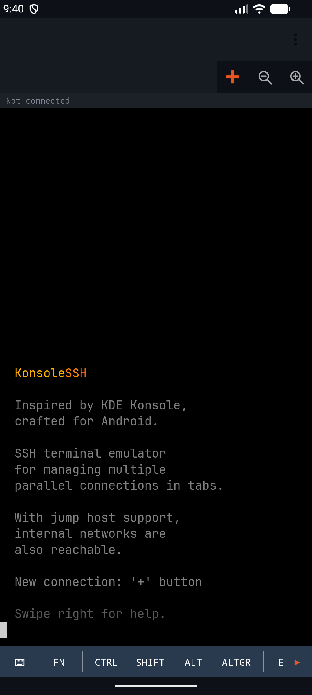
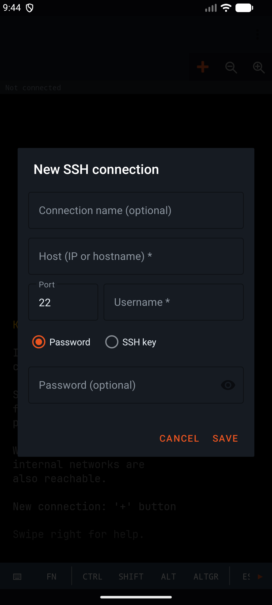
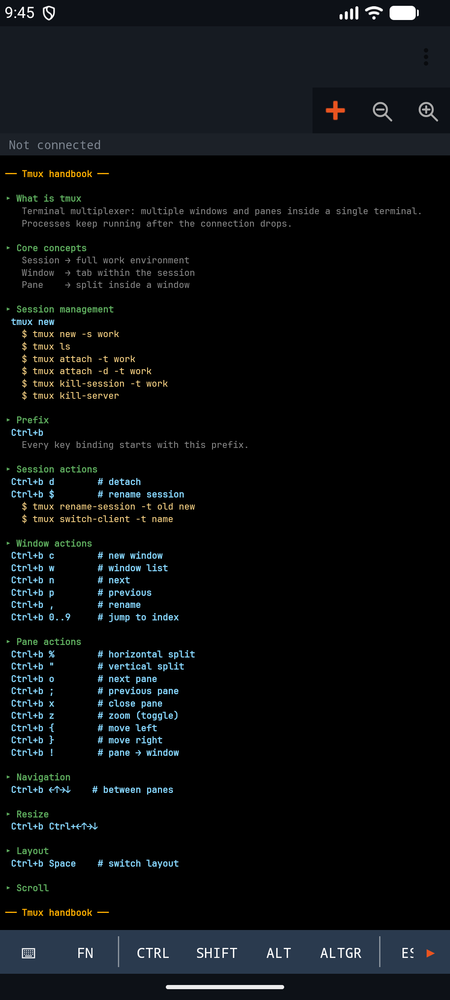
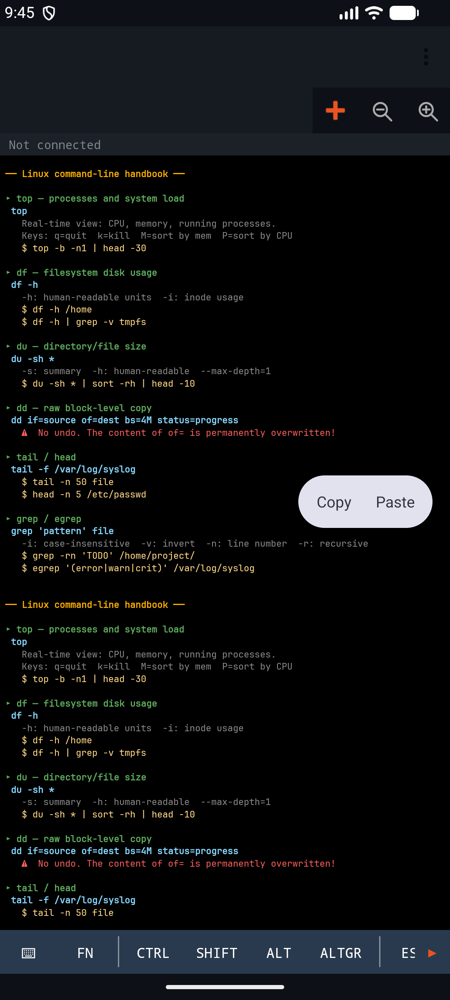

# KonsoleSSH

Terminal SSH multi-pestaña para Android — inspirado en KDE Konsole.

> **Idioma:** Español · [English](README.md) · [Magyar](README.hu.md) · [Deutsch](README.de.md) · [Français](README.fr.md) · [Slovenčina](README.sk.md) · [Română](README.ro.md)

## Capturas de pantalla

| Pantalla de bienvenida | Nueva conexión SSH |
| --- | --- |
|  |  |

| Referencia de tmux | Referencia de Linux |
| --- | --- |
|  |  |

## Funcionalidades

### Pestañas y navegación

- **Interfaz multi-pestaña** — TabLayout + ViewPager2, cada pestaña tiene su propia sesión SSH independiente, identificada por un `TabInfo` basado en UUID
- **Tres páginas fijas** — pantalla de bienvenida (posición 0), chuleta de Linux y chuleta de tmux (últimas dos posiciones); las pestañas SSH viven entre ellas
- **Punto de estado de conexión en cada pestaña** — verde (CONNECTED), amarillo (CONNECTING), rojo (DISCONNECTED), oculto (NONE)
- **Pulsación larga sobre una pestaña** → diálogo de renombrado
- **Botón ✕ de la pestaña** — pide confirmación en sesiones activas; cierra al instante si está desconectada
- **Desplazamiento de la fila de pestañas** — cuando las pestañas desbordan, aparecen botones ◀/▶ con pulso suave (ObjectAnimator ±8dp, 900ms reverse infinite)
- **Altura del indicador de pestaña puesta a 0dp** con una sola pestaña (menos ruido visual)

### Selector de pestañas / conexiones guardadas (menú `+`)

- **BottomSheetDialogFragment** — altura completa (STATE_EXPANDED, MATCH_PARENT)
- **Árbol de pestañas activas + conexiones guardadas**, apilados
- **Agrupación en árbol por prefijo con guion bajo** — `acme_prod_web`, `acme_prod_db` → grupo `acme_` → `prod_`; una sola hoja nunca se agrupa
- **Relleno según profundidad** — `16dp + profundidad × 20dp`
- **El estado expandido se mantiene al reabrir el diálogo** (respaldado por companion object)
- **Iconos** — grupo: 📁 / 📂 (cerrado/abierto), hoja: ⚡
- **Filas de hoja** — sublínea `user@host:port`, editar y eliminar a la derecha
- **Filas de grupo** — sublínea con el número de hojas, flecha ▶/▼ a la derecha
- **Nombre de usuario más reciente** prellenado en nuevas conexiones

### Diálogo Nueva / Editar

- **Modo edición** — `ConnectionConfig` completo serializado con Gson a través del Bundle y restaurado en los campos
- **Conmutador de autenticación** RadioGroup: contraseña ↔ clave privada, el layout irrelevante se oculta automáticamente
- **Clave privada con selector de archivos** (vista previa de solo lectura), campo separado para la frase de paso
- **Aviso de `.pub`** — toast si el usuario intenta cargar la mitad pública de la clave
- **Línea de estado de la clave** — PEM cargada / fallida / ninguna
- **Spinner de jump host** — lista las conexiones guardadas (excluida la propia)
- **Sugerencia automática de jump** — detecta prefijos de IP privada (`10.`, `172.`, `192.`) y expande la sección de jump
- **Validación** — host y usuario obligatorios; puerto 1–65535, por defecto 22

### Autenticación de la conexión

- **JSch (fork de mwiede)** — contraseña, publickey o ambos combinados (`buildPreferredAuths`)
- **Solicitud interactiva de contraseña** — cuando no hay ninguna guardada, un AlertDialog con estilo `KonsoleDialog` (texto blanco, fondo transparente)
- **Keyboard-interactive auth** — los prompts del servidor pasan por el mismo diálogo
- **Timeout de 30 s en el prompt** (CountDownLatch) — el hilo llamador se libera limpiamente si el usuario no responde
- **Guardia de hilo principal** — el diálogo siempre aparece en el hilo de UI (Handler post)
- **Cadena de jump host** — `setPortForwardingL(0, target_host, target_port)` del fork de mwiede en un puerto aleatorio + segunda sesión al loopback
- **Mensajes de progreso del jump** impresos en la terminal — `Jump: host:port → Connecting`, luego `Jump OK → Connecting: target:port`
- **Error "Jump host no encontrado"** — cuando un ID de jump-connection referenciado ya no existe

### Emulador de terminal (basado en Canvas)

**Renderizado**

- `TerminalView` personalizado, `canvas.drawText` por celda, base mínima 80×24
- Campos por celda: carácter (String, consciente de surrogate pairs), fg/bg, negrita, subrayado, invertido
- **NerdFont incluida** (`assets/fonts/NerdFont.ttf`); fallback a `Typeface.MONOSPACE` si falla el asset
- Rango de fuente 6sp…40sp; el primer layout autoescala para ajustarse a un objetivo de 80 columnas
- **Botones de zoom +/−** en la barra de herramientas (`SharedPreferences("settings", "font_size")`), persiste entre reinicios
- Tamaño de fuente **por aplicación** (no por conexión)
- Subrayado renderizado mediante `drawLine` en cellH-1
- Inversión del cursor en el momento del dibujo (fg↔bg)
- **Parpadeo del cursor** 600 ms encendido / 300 ms apagado

**Máquina de estados ANSI/VT**

- Estados NORMAL / ESCAPE / CSI / OSC / DCS / CHARSET
- SGR: 16 base + 8 brillantes + cubo 256 + truecolor (`38;2;r;g;b`), negrita/subrayado/invertido + resets
- Cursor: A/B/C/D, H/f, G, E/F, s/u, ESC 7/8 (DEC legacy)
- Borrado: J, K, X, L/M (insertar/borrar líneas), P/@ (caracteres)
- **Región de scroll** — r, S/T (scroll up/down)
- **Pantalla alternativa** — toggle 47 / 1049 (vi, top, less, mc preservan y restauran la pantalla)
- **Modo DECCKM app-cursor** — `ESC[A/B/C/D` ↔ `ESC O A/B/C/D`
- **Bracketed paste mode** (2004) — el texto pegado se envuelve en `ESC[200~ … ESC[201~`

**Selección de texto**

- **Pulsación larga de 400 ms** → inicia selección, `ActionMode` flotante (Copiar/Pegar)
- Seguimiento en vivo del punto final durante el arrastre, `invalidateContentRect`
- Normalización de dirección adelante/atrás
- `buildSelectedText` — recorta cada línea, une con `\n`
- Toque durante la selección → cancela la selección
- **Bloqueo del swipe de ViewPager** (`requestDisallowInterceptTouchEvent`) durante selección/scroll

**Desplazamiento y toque**

- Scroll vertical: `scrollRowOff` 0…`scrollback.size`
- Anillo de **scrollback** de 3000 líneas
- El scroll horizontal es opcional (desactivado en la página de bienvenida)
- **Umbral de movimiento de 8 px** — discrimina toque vs. scroll
- Gravedad inferior automática en nueva salida (`scrollRowOff = 0`)
- Toque → `focusAndShowKeyboard()`
- **Shift+PageUp/Down** en un teclado físico desplaza por el scrollback

**Integración con IME**

- `TerminalInputConnection` personalizado (BaseInputConnection)
- Truco del centinela: el buffer siempre empieza con un espacio centinela, la entrada del usuario usa `removePrefix`
- Funciona con IMEs swipe/glide
- `deleteSurroundingText` → stream manual de bytes DEL (0x7F)
- `inputType=TYPE_NULL` — sin autocompletado ni sugerencias en la terminal

### Teclado físico

- Enter→13, Tab→9, Esc→27, DEL→127
- Home/End → `ESC[H` / `ESC[F`
- PageUp/PageDown → `ESC[5~` / `ESC[6~`
- **F1–F12** → `ESC O P/Q/R/S`, `ESC[15~`, `ESC[17~`, …
- Flechas → códigos según el modo app-cursor
- Shift+PageUp/Down se desvían al scrollback (no se envían como entrada)

### Barra de teclas en pantalla

**Fila principal** (40 dp)

- **⌨** — conmuta el IME del sistema. Visibilidad real del IME leída mediante `WindowInsetsCompat`, de modo que un teclado descartado por el gesto de atrás se reabre limpiamente.
- **Fn** — conmuta la fila F1–F12
- **CTRL / SHIFT / ALT / ALTGR** — modificadores sticky, resaltados con `keybar_mod_active` mientras están activos; **reset automático** tras cualquier envío de tecla
- **CTRL** también abre una fila dedicada de combinaciones Ctrl (A/B/C/D/V/Z)
- **ESC, TAB** — byte directo
- **↑** — conmuta una fila de flechas (← ↑ ↓ →)
- **📁** — `ActivityResultContracts.OpenDocument()` → subida SFTP
- Separadores visuales `KeyBarDivider` entre medias

**Fila Fn** (36 dp) — secuencias escape F1–F12, cada pulsación **parpadea** durante 300 ms (color de acento)

**Fila Ctrl** — generada dinámicamente (`LayoutInflater` + `item_keybar_button`)

- `Ctrl+C`: copia la selección al portapapeles interno de la app con un toast, si no envía ETX (0x03)
- `Ctrl+V`: pega desde el portapapeles interno → `pasteText` + toast
- A/B/D/Z: código = char - 'A' + 1 (1…26)

**Fila de flechas** (36 dp) — ← ↑ ↓ → respetando el modo app-cursor

**Indicadores de desplazamiento en cada fila** — ◀/▶ animados solo cuando realmente hay scroll disponible; `canScrollHorizontally(±1)` comprobado tras cada evento; animator cancel + reset en onDestroy

### Combinaciones de teclas especiales (`applyModifiers`)

- Ctrl+letra → 1…26 (códigos de control estándar)
- **Ctrl+espacio → 0x00 (NUL)**
- **Ctrl+[ → 27 (ESC)**
- Shift + minúscula → mayúscula (fallback para soft-input)
- Alt / AltGr → `ESC` + byte original (prefijo meta)

### Portapapeles

**Portapapeles interno de la app** (`TerminalClipboard`)

- Singleton `var text: String?`
- Ctrl+C con selección → portapapeles **interno** (no el del sistema) + toast discreto
- Ctrl+V → interno → `pasteText`

**Portapapeles del sistema**

- ActionMode **Copiar** → `ClipboardManager.setPrimaryClip`
- ActionMode **Pegar** → `coerceToText` → `pasteText`
- Al pegar `\n` → `\r`, envuelto si el bracketed paste mode está activo

### Subida de archivos SFTP

- 📁 → selector `OpenDocument`
- Nombre de archivo desde `OpenableColumns.DISPLAY_NAME`, fallback `uri.lastPathSegment`
- Consulta de tamaño → conmutación entre barra de progreso determinada / indeterminada
- **Diálogo de progreso** — nombre de archivo, `X.X MB / Y.Y MB` o `Z.Z MB` cuando el total es desconocido, `setCancelable(false)`
- Al éxito `KonsoleToast.showWithAction` — "Subido: ~/filename" + botón **Deshacer** → `deleteRemoteFile`
- En caso de error, mensaje localizado mapeado por friendlyError

### Estado y retroalimentación

- **Barra de estado** (20 dp) encima de la terminal: `Sin conexión`, `Conectando: host…`, `Conectado: host`, `Desconectado: host`
- **Botón reconectar** en el centro de la terminal, icono ↺, visible solo cuando DISCONNECTED
- **KonsoleToast** — toast personalizado, margen inferior de 100 dp, 4000 ms por defecto / 3000 ms con acción, animación de descarte (scale+alpha, 250 ms)

### Mensajes de error (mapeo friendlyError)

Las excepciones crudas de JSch se mapean a texto legible (localizado):

- `connection refused` → "El servidor rechazó la conexión"
- `timed out` / `timeout` → "Tiempo de espera agotado"
- `no route to host` → "No hay ruta al host"
- `network unreachable` → "Red inalcanzable"
- `unknown host` → "Host desconocido"
- `auth fail` / `authentication` → "Autenticación fallida"
- `connection closed` / `closed by foreign host` → "Conexión cerrada"
- `broken pipe` → "Tubería rota"
- `port forwarding`, `channel` → mensajes dedicados
- En otro caso: el mensaje de la excepción con los prefijos de clase del stack eliminados por regex

### Fondo y ciclo de vida

- **`SshForegroundService`** — `START_STICKY`, deliberadamente **no** detiene las sesiones en `onTaskRemoved`
- **Buffer de salida** — anillo de 256 KB por sesión, `ByteArrayOutputStream` con recorte por desbordamiento
- **Replay al reconectar** — tras el bind del fragment, el buffer se reproduce en la terminal para que la salida previa sea visible
- **Dos NotificationChannels** — `ssh_idle` (inactivo) y `ssh_active` (activo), comportamiento distinto del badge
- **Badge de notificación** muestra el número de sesiones activas
- Notificación de baja prioridad (`PRIORITY_LOW`, `setSilent`)
- `onRebind` habilitado (`onUnbind → true`)
- `TerminalFragment.onDestroy` **no** desconecta (la sesión la posee el servicio)
- Bookkeeping de listeners en `onAttach`/`onDetach` (seguro frente a memory leaks)

### Máquina de estados del indicador de conexión

- `NONE → CONNECTING`: nueva llamada a `connect()`
- `CONNECTING → CONNECTED`: canal shell abierto (`onConnected`)
- `CONNECTING → DISCONNECTED`: `onError` (auth, timeout, refused)
- `CONNECTED → DISCONNECTED`: el bucle de lectura termina o `disconnectSession` explícito
- `DISCONNECTED → CONNECTING`: botón reconectar

### Seguridad

- **AES-256-GCM con Android Keystore** — los perfiles de conexión se cifran con una clave no exportable del Keystore (IV aleatorio, etiqueta de 128 bits); los datos antiguos de EncryptedSharedPreferences se migran automáticamente
- **Migración legacy** en la primera ejecución — los perfiles antiguos en texto plano se trasladan al almacén cifrado, luego el almacén legacy se limpia
- **Sin texto plano ni sobrescritura silenciosa** — si el cifrado falla no se escribe nada; un almacén ilegible se notifica y nunca se sobrescribe
- **Verificación de la clave del host (TOFU)** — en la primera conexión se confirma la huella SHA256 de la clave del servidor y después se comprueba en cada conexión; una clave cambiada solo se acepta si se sustituye expresamente
- Las credenciales nunca salen del dispositivo

### Bienvenida / chuletas

- **Banner de bienvenida** — "KonsoleSSH" coloreado en tres tonos de naranja con ANSI + 9 líneas de descripción (`[38;5;244m` tenue)
- Fuente fija de 16 sp en la página de bienvenida
- Scroll horizontal desactivado en la página de bienvenida
- **Chuleta de Linux** — `top`, `df`, `du`, `dd`, `tail`, `head`, `grep`, `egrep`, `awk`, `sed`, `tr`, `ip`, `mc` + icono de aviso `⚠` en comandos destructivos (`dd`, `sed -i`)
- **Chuleta de tmux** — sesiones/ventanas/paneles/layouts/prefijo/resize/scroll/paste
- **Contenido según idioma** — HU y EN escritos por separado, no mera traducción de etiquetas
- `scrollToTop()` al abrir
- El resize de la terminal en una pestaña de chuleta rerrenderiza por completo (`clear()` + nuevo banner)

### Edge-to-edge y orientación

- `ViewCompat.setOnApplyWindowInsetsListener` en cada Activity
- `Type.systemBars() | Type.displayCutout()` + `Type.ime()` gestionados juntos — en horizontal el contenido queda por encima de la barra de navegación, al aparecer el IME el contenido sube
- `screenOrientation=fullSensor` — auto-rotación vertical + horizontal
- `configChanges` configurado para que la Activity no se destruya al rotar
- `windowSoftInputMode=adjustResize`
- `onSizeChanged` → recálculo de fuente, recalibración de termRows/termCols

### Localización

- 7 idiomas: **inglés** (por defecto), **húngaro**, **alemán**, **español**, **francés**, **eslovaco**, **rumano**
- `supportsRtl="true"` — preparado para futuros idiomas RTL
- Sigue el idioma del sistema
- El contenido de las chuletas también está localizado (HU/EN)

### Detalles de comodidad

- El foco vuelve automáticamente a la terminal tras cerrarse el ActionMode
- Tras soltar un botón modificador, el foco vuelve a la terminal
- El botón modificador sticky cambia de color mientras está activo (estado visual claro)
- Cada toque en la barra de teclas parpadea 300 ms
- DEL (0x7F) se envía como código distinto — no como alternativa al Backspace
- Surrogate pair / emoji almacenado como un único carácter lógico por celda
- Resize de la terminal → `resize(tabId, cols, rows)` al PTY (`vim`, `htop` detectan el nuevo tamaño)
- `resetToSentinel` del input-connection tras cada commit — estado del IME siempre limpio
- Mensaje "Conexión cerrada" impreso en la terminal al desconectar
- Ctrl+C / Ctrl+V muestran un toast discreto: "Copiado" / "Pegado"
- Los botones usan ripple `selectableItemBackgroundBorderless`
- Estilo `KonsoleDialog`: texto blanco, hint gris, fondo transparente
- Cerrar/eliminar/salir con una conexión activa siempre pide confirmación

### Constantes

- Connect timeout: 15 s, shell-connect: 10 s, prompt de contraseña: 30 s
- Buffer de salida: 256 KB / sesión
- Scrollback: 3000 líneas
- Fuente: 6 sp – 40 sp
- Pulsación larga: 400 ms
- Umbral de movimiento táctil: 8 px
- Pulso de indicador de scroll: periodo de 900 ms, ±8 dp
- Toast: 4000 ms por defecto, 3000 ms con acción, anim de descarte 250 ms
- Margen inferior de KonsoleToast: 100 dp
- Parpadeo del cursor: 600 ms encendido / 300 ms apagado

## Arquitectura

Las sesiones las posee `SshForegroundService`, no los fragments:

- Las conexiones sobreviven a la recreación de la activity (rotación, botón atrás, cierre de tarea)
- `TerminalFragment` se engancha/desengancha al servicio en `onStart`/`onStop` y reproduce el buffer de salida al reconectar
- `OutputBuffer` mantiene los últimos 256 KB de salida por sesión

## Estructura del proyecto

```
app/src/main/java/hu/billman/konsolessh/
model/ConnectionConfig.kt              — datos de la conexión SSH (host, puerto, usuario, autenticación, jump)
data/ConnectionRepository.kt           — conexiones guardadas; suspend, main-safe; almacén ilegible → excepción
data/CryptoBoxConnectionRepository.kt  — almacén AES-256-GCM (Android Keystore), migración de datos antiguos
data/SettingsRepository.kt             — ajustes pequeños (tamaño de fuente)
ssh/SshSession.kt                      — sesión JSch: cadena de jump, shell, subida/borrado SFTP
ssh/JumpChain.kt                       — resolución y túneles de jump hosts de varios saltos
ssh/TofuHostKeyRepository.kt           — verificación de la clave de host (confianza en el primer uso)
ssh/SshKeyProvisioner.kt               — prueba de conexión y subida de la clave pública
ssh/SshError.kt                        — errores SSH tipados y su clasificador
session/SessionManager.kt              — única fuente de verdad: pestañas, estado, salida, preguntas
session/PromptBroker.kt                — preguntas de contraseña y clave de host como estado
service/SshForegroundService.kt        — mantiene vivo el proceso, notificación
terminal/TerminalView.kt               — emulador de terminal sobre Canvas (VT100/xterm-256color)
terminal/AnsiParser.kt                 — máquina de estados ANSI/VT
terminal/KeyModifiers.kt               — lógica de Ctrl/Shift/Alt/AltGr fijos
ui/MainActivity.kt                     — pantalla principal: pestañas, páginas, preguntas, errores
ui/MainViewModel.kt                    — estado y comandos de la pantalla principal
ui/SshTerminalFragment.kt              — una pestaña SSH (solo recibe el id de la pestaña)
ui/StaticTerminalFragment.kt           — página de bienvenida, chuletas de Linux y tmux
ui/NewConnectionDialog.kt              — crear / editar / probar una conexión
ui/keybar/KeybarController.kt          — barra de teclas en pantalla
AppContainer.kt                        — inyección de dependencias manual (composition root)
```

## Construcción

```
Kotlin       2.2.10
AGP          9.5.1
Gradle       9.6.0
Java target  17
namespace    hu.billman.konsolessh
minSdk       26   (Android 8.0)
targetSdk    37   (Android 17)
```

```bash
# Compilación debug + tests unitarios
./gradlew :app:testDebugUnitTest

# App Bundle firmado para release (requiere un keystore configurado)
./gradlew :app:bundleRelease
```

La build **release** se minifica con R8 y se reducen recursos. El código basado en reflexión
(JSch, modelos de Gson) se preserva mediante `app/proguard-rules.pro`. Se produce `mapping.txt`
para que Play Console pueda desofuscar los stack traces.

## Permisos

| Permiso                               | Motivo                                                |
| ------------------------------------- | ----------------------------------------------------- |
| `INTERNET`                            | Conexión SSH                                          |
| `ACCESS_NETWORK_STATE`                | Verificación del estado de la red                     |
| `CHANGE_NETWORK_STATE`                | Foreground service (tipo connectedDevice)             |
| `FOREGROUND_SERVICE`                  | Iniciar el servicio en segundo plano                  |
| `FOREGROUND_SERVICE_CONNECTED_DEVICE` | Foreground service de red (API 34+)                   |
| `POST_NOTIFICATIONS`                  | Notificación persistente de sesión (API 33+)          |
| `ACCESS_LOCAL_NETWORK`                | Hosts SSH de la red local en Android 17+ (API 37+) |

No se recopilan, comparten ni envían datos. Las credenciales permanecen en el dispositivo en el almacenamiento cifrado del Keystore.

## Requisitos

- Android 8.0 (API 26) o superior
- Modos vertical y horizontal soportados

## Licencia

La aplicación se distribuye bajo la licencia **GPL-3.0-or-later** — el texto completo está en el archivo [LICENSE](LICENSE). Es software libre: puedes usarlo, estudiarlo, modificarlo y redistribuirlo libremente; los trabajos derivados deben permanecer bajo la misma licencia.

## Historial de versiones

- **1.1.27** — arquitectura por capas tras una auditoría de código: un único gestor
  de sesiones como fuente de verdad, las preguntas llegan como estado y sobreviven
  al giro, errores tipados con un solo traductor de mensajes; un almacén de
  conexiones ilegible ya no se sobrescribe y nunca se guarda nada sin cifrar; los
  secretos ya no van en los argumentos de los fragmentos; al editar se conserva la
  frase de paso de la clave; comando de subida de clave más seguro
- **1.1.26** — verificación de la clave de host del servidor (confianza en el primer
  uso, huella SHA256, aviso si cambia); jump hosts de varios saltos (un jump host
  puede tener su propio jump host, hasta 5 saltos), usados también por la prueba de
  conexión y la subida de claves; claves de host Ed25519 e intercambio curve25519
  mediante Bouncy Castle; perfiles cifrados excluidos de la copia de seguridad;
  texto copiado del terminal marcado como sensible; los mensajes del terminal ya no
  muestran una «r» sobrante
- **1.1.25** — objetivo Android 17 (API 37): permiso de red local, gesto atrás
  predictivo, AGP 9.5 / Gradle 9.6
- **1.1.24** — la prueba de conexión funciona con clave privada
- **1.1.23** — logotipo y título «KonsoleSSH» en la barra de herramientas
- **1.1.22** — opción Salir al final del menú de tres puntos
- **1.1.21** — análisis estático (detekt, ktlint) y control de calidad en CI,
  Dependabot, OSV-Scanner
- **1.1.20** — limpieza: Node.js 24 en CI, configuración de idiomas
- **1.1.19** — actualización de dependencias (security-crypto estable)
- **1.1.18** — CI, eliminación de código muerto, correcciones de ciclo de vida y
  lint
- **1.1.17** — keep-alive de SSH; los mensajes del sistema ya no aparecen bajo el
  prompt
- **1.1.16** — corrección: cierre inesperado al girar (condición de carrera en el
  ciclo de vida del Fragment)
- **1.1.15** — las sesiones y diálogos sobreviven al giro
- **1.1.14** — capa MVVM (ViewModels)
- **1.1.13** — tecla Supr (borrado hacia delante) por SSH
- **1.1.12** — cifrado AES-256-GCM propio (Android Keystore) con migración atómica
  de perfiles antiguos
- **1.1.11** — línea de versión en el banner de bienvenida
- **1.1.10** — flujo de eventos entre el servicio y la interfaz (Kotlin Flow)
- **1.1.4–1.1.9** — refactorización interna (búfer del terminal, repositorio de
  conexiones, generador de claves), actualización de dependencias, correcciones de
  lint
- **1.1.3** — errores de conexión en un toast; la pestaña se cierra sola tras 5 s
- **1.1.2** — mensajes distintos para tres tipos de error de conexión
- **1.1.1** — subida de clave solo tras una prueba correcta; la clave pública se
  sube con autenticación por contraseña
- **1.1.0** — generador de claves SSH integrado
- **1.0.9** — orden de autenticación publickey primero, explicación del error «Auth
  cancel»
- **1.0.8** — selector de idioma en el menú de tres puntos
- **1.0.7** — licencia GPL-3.0 añadida, build compatible con F-Droid (configuración de firma condicional)
- **1.0.6** — el indicador de estado de reconexión ahora se pone correctamente en verde
  (ya no se queda en amarillo); el icono del teclado abre el IME de forma fiable en
  Android 14+ (visibilidad real basada en `WindowInsetsCompat` en lugar del obsoleto `SHOW_FORCED`)
- **1.0.5** — corrección interna (versión omitida)
- **1.0.4** — nuevo icono más fino `>_` estilo prompt (diseño de stroke)
- **1.0.3** — icono y recursos refinados para Play Store
- **1.0.2** — paquete renombrado a `hu.billman.konsolessh`, correcciones de edge-to-edge,
  teclado virtual sólo a petición, subida SFTP con diálogo de progreso y toast de
  Deshacer, minificación R8, Gradle 9.4.1 / AGP 9.2.0
- **1.0.1** — `targetSdk = 35`, primer envío a Play
- **1.0.0** — SSH multi-pestaña, jump host, árbol de conexiones guardadas,
  referencias Linux y tmux, traducción al húngaro
