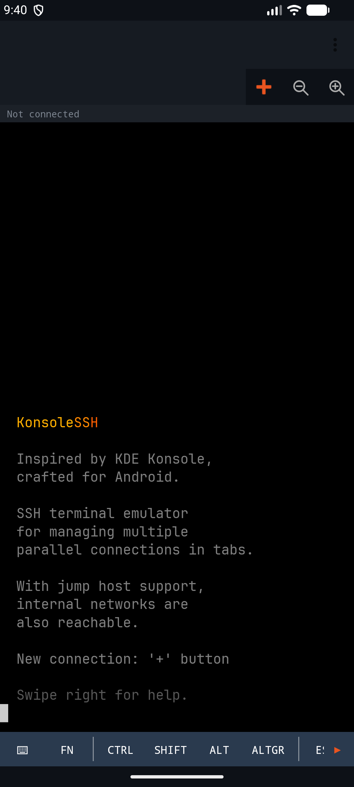

# KonsoleSSH

Multi-tab SSH terminal for Android, inspired by KDE Konsole.

> **Language:** English · [Magyar](README.hu.md) · [Español](README.es.md) · [Deutsch](README.de.md) · [Français](README.fr.md) · [Slovenčina](README.sk.md) · [Română](README.ro.md)

## Screenshots

| Welcome screen | New SSH connection |
| --- | --- |
|  |  |

| Tmux cheat sheet | Linux cheat sheet |
| --- | --- |
|  |  |

## Features

**Tabs**
- Any number of SSH sessions side by side, each in its own tab, switched by swiping or from the tab strip.
- A status dot on every tab: connecting, connected or disconnected; a disconnected tab offers a reconnect button.
- Long-press a tab to rename it; closing a connected tab asks first.
- The welcome page comes first; a Linux and a tmux cheat sheet follow the last tab.

**Connections**
- Saved connections in a tree: names sharing an underscore prefix (`acme_prod_web`, `acme_prod_db`) are grouped.
- Password or private key authentication, keyboard-interactive prompts included. A password that is not saved is asked for when connecting.
- Jump hosts, also chained: a jump host may have its own jump host, up to 5 hops. For a private address the form suggests one.
- Connection test, and generating an RSA key and uploading its public half to the server's `authorized_keys`.
- Host keys are checked on trust on first use: the SHA256 fingerprint is shown at the first connection, and a changed key is refused unless the user replaces it explicitly.

**Terminal**
- xterm-compatible emulation: 16, 256 and true colour, alternate screen, scroll region, bracketed paste, application cursor keys, DEC line drawing, wide CJK and emoji characters. Compared against tmux on recorded bash, vim, less, htop and mc sessions.
- 3000 lines of scrollback; text selection with copy and paste; zoom with the buttons in the tab strip, remembered across restarts.
- Hardware keyboards work, including function keys, Home/End, PageUp/PageDown and Shift+PageUp/PageDown for the scrollback.

**Key bar**
- Sticky Ctrl, Shift, Alt and AltGr; a modifier applies to the next key, then releases.
- Esc, Tab, a function key row (F1–F12), an arrow key row, and a Ctrl row (Ctrl+A…Z; Ctrl+C copies a selection, otherwise interrupts).
- Uploads a file over SFTP into the remote home directory, with progress and an Undo for a few seconds afterwards.

**Other**
- Sessions keep running in the background behind a notification that counts the active connections.
- Seven languages: English, Hungarian, German, Spanish, French, Slovak, Romanian; selectable inside the app.
- Optional Google Drive sync: saved connections (with passwords and keys) and accepted host keys sync between devices through a hidden folder in the user's own Google Drive, end-to-end encrypted with a passphrase only the user knows. A new device offers to restore them on first start.

## Architecture

- **UI:** Jetpack Compose with Material 3 in a single activity; the screens (main screen, saved connections, sync) are Navigation 3 destinations.
  The terminal itself is a Canvas-based view (`TerminalView`) hosted in Compose.
- **State:** a single `SessionManager`, living as long as the application, owns the tabs, their
  sessions, output and pending questions. The UI observes its state through ViewModels and sends
  commands; a password or host key question is state, so it survives a rotation.
- **Background:** `SshForegroundService` only keeps the process alive and shows the notification;
  it runs while a tab is connecting or connected and stops itself afterwards.
- **Storage:** connections in an AES-256-GCM encrypted DataStore file (Android Keystore key, excluded
  from backup); settings in DataStore Preferences; host keys in an OpenSSH-style `known_hosts` file.
  An unreadable store is reported, never overwritten.
- **Terminal model:** `TerminalBuffer` is plain Kotlin without Android dependencies, so it is
  unit-tested on the JVM.
- **Dependencies** are wired by hand in `AppContainer`, without a DI framework.
- **Sync** (optional): `SyncManager` merges this device's connections and host keys with an AES-256-GCM encrypted file in Drive's hidden app data folder; the key comes from the user's passphrase (PBKDF2) and never leaves the devices.

## Project structure

```
app/src/main/java/hu/billman/konsolessh/
  model/        ConnectionConfig: the saved connection
  data/         encrypted connection store, settings, removal of old stores
  ssh/          JSch sessions, jump chain, host key checks, key upload, typed errors
  session/      SessionManager, output buffer, password and host key questions
  sync/         Google Drive sync: encryption, merge, Drive client
  terminal/     TerminalView and TerminalBuffer: rendering, input, emulation
  service/      the foreground service
  ui/           Compose screens, ViewModels, key bar, theme
  AppContainer.kt  the dependency graph
```

## Build

```
Kotlin 2.4 · AGP 9.5 · Gradle 9.6 · Java 17
minSdk 26 (Android 8.0) · targetSdk / compileSdk 37 (Android 17)
```

```bash
./gradlew detekt :app:testDebugUnitTest :app:lintDebug   # checks and unit tests
./gradlew :app:connectedDebugAndroidTest                 # UI tests on a device or emulator
./gradlew :app:bundleRelease                             # signed App Bundle (needs a keystore)
```

The unit tests include integration tests against real OpenSSH servers; they need `sshd` installed
and are skipped without it. The release build is minified with R8.

## Usage

1. **New connection:** tap `+` → *New connection…*, enter host, port, user name and a password or key.
2. **Jump host:** open *Configure jump host…* in the form and pick a saved connection as the gateway.
3. **Rename or close a tab:** long-press it, or tap its `✕`.
4. **Zoom:** the magnifier buttons next to `+`.
5. **Cheat sheets:** swipe past the last tab.
6. **Upload a file:** 📁 in the key bar; the file goes to the remote home directory (`~`).
7. **Exit:** the menu (⋮) → *Exit*, or `+` → *Exit*.

## Dependencies

| Library | Purpose |
| --- | --- |
| JSch (mwiede fork) | SSH and SFTP |
| Bouncy Castle | Ed25519 host keys and curve25519 key exchange for JSch |
| Jetpack Compose, Material 3 | UI |
| AndroidX Lifecycle, Activity | ViewModels, lifecycle-aware state |
| kotlinx.coroutines | asynchronous SSH I/O |
| kotlinx.serialization | the connection store's format |
| AndroidX DataStore | connection store and settings |
| AndroidX AppCompat | in-app language selection on Android 8–12 |
| Google Play services auth | authorization for the optional Google Drive sync |
| androidx.security | only to migrate stores written before 1.1.12 |

Exact versions are in `gradle/libs.versions.toml`.

## Permissions

| Permission | Reason |
| --- | --- |
| `INTERNET` | SSH connections |
| `ACCESS_NETWORK_STATE` | checking reachability |
| `FOREGROUND_SERVICE`, `FOREGROUND_SERVICE_SPECIAL_USE` | keeping open sessions alive in the background (API 34+) |
| `POST_NOTIFICATIONS` | the session notification (API 33+) |
| `ACCESS_LOCAL_NETWORK` | hosts on the local network (Android 17+) |

No data is collected or sent anywhere. Credentials stay on the device, encrypted.

## License

GPL-3.0-or-later; see [LICENSE](LICENSE).

## Release history

- **2.3.0** — the tab picker closes with a sideways swipe, left or right, or
  with its new Back row, which replaces Exit there; leaving the app stays in
  the main menu. With Google Drive sync on, the app also syncs whenever it
  comes to the foreground, and a change still waiting to upload goes out at
  once when the app goes to the background
- **2.2.0** — optional Google Drive sync: saved connections, with their
  passwords and keys, and the accepted host keys sync between devices through
  a hidden folder in the user's own Google Drive, end-to-end encrypted with a
  passphrase only the user knows. On a first start with nothing saved, the
  app offers to restore them. The privacy policy describes the sync
- **2.1.0** — closing the last tab shows the welcome page again instead of a
  cheat sheet; a selection started with a long press stays when the finger is
  lifted without dragging; with a large system font the terminal follows
  Android 14's non-linear scaling; counted texts use the right singular and
  plural forms in every language; the screen follows the system rotation
  lock; typing into a prefilled form field continues at its end; tapping the
  terminal is available to accessibility services
- **2.0.0** — a new storage format and a rebuilt interface. Saved connections
  move into an encrypted DataStore file and settings into DataStore; the
  upgrade migrates them once and removes the old files, so 1.x can no longer
  read them afterwards. Every screen is rebuilt with Jetpack Compose and
  Material 3. A file upload keeps running through a rotation; the jump host
  suggestion recognises private addresses by their real ranges; swiping
  between tabs works over the terminal too. The background service uses the
  `specialUse` foreground service type. The menu links to the privacy policy
- **1.1.30** — quality work driven by tests. Terminal: compared against tmux on
  recorded bash, vim, less, htop and mc sessions; fixed CSI sequences with an
  intermediate byte (vim's cursor shape printed a stray `q`), back colour erase
  (mc's coloured panels), VPA/HPA/REP and tab-by-count (htop was one line off),
  xterm alternate-screen modes, the main screen behind vim surviving a rotation,
  SGR dim/italic/strikethrough, and huge repeat counts that could stall the
  parser. SSH: closing a tab while it connects no longer leaves a half-open
  connection behind (for up to 2 minutes); a damaged known_hosts line can no
  longer become a trusted key. Real-sshd integration, fault-injection and
  emulator UI tests run in CI, with coverage
- **1.1.29** — terminal emulation: wide characters (CJK, emoji) take two cells
  as on the server, combining marks join the previous cell, DEC line drawing
  (`ESC ( 0`) for ncurses/dialog/mc frames, cursor position and device queries
  (`CSI 6n`, DA) are answered — but not again when output is replayed after
  rotation; text is drawn in runs instead of cell by cell. Problem reports: after
  an ANR or crash the app offers to share a report (version, device, trace — no
  secrets); nothing is sent automatically. The foreground service runs only while
  a session is active. Key files are read off the main thread. Fixed: cheat sheets
  showed twice after a resize
- **1.1.28** — terminal output is parsed on a background thread in slices, so
  large output (`cat` of a big log, `find /`) no longer stalls the UI; multibyte
  UTF-8 characters split across network reads are no longer garbled
- **1.1.27** — layered architecture after a code audit: a single session manager is
  the source of truth, prompts arrive as state and survive rotation, typed errors
  with one message mapper; an unreadable connection store is no longer overwritten
  and nothing is ever saved unencrypted; secrets are no longer passed in fragment
  arguments; editing keeps the key passphrase; safer key upload command
- **1.1.26** — server host key verification (trust on first use, SHA256 fingerprint,
  warning on change); multi-hop jump hosts (a jump host may have its own jump host,
  up to 5 hops), also used by the connection test and key upload; Ed25519 host keys
  and curve25519 key exchange via Bouncy Castle; encrypted profiles excluded from
  backup; text copied from the terminal marked as sensitive; terminal messages no
  longer show a stray "r"
- **1.1.25** — targets Android 17 (API 37): local network permission, predictive
  back, AGP 9.5 / Gradle 9.6
- **1.1.24** — connection test works with a private key
- **1.1.23** — app logo and "KonsoleSSH" title in the toolbar
- **1.1.22** — Exit item at the end of the overflow menu
- **1.1.21** — static analysis (detekt, ktlint) and CI quality gate, Dependabot,
  OSV-Scanner
- **1.1.20** — cleanup: Node.js 24 in CI, locale configuration
- **1.1.19** — dependency updates (security-crypto stable)
- **1.1.18** — CI, dead-code removal, lifecycle and lint fixes
- **1.1.17** — SSH keep-alive; system messages no longer appear under the prompt
- **1.1.16** — fix: crash on rotation (Fragment lifecycle race)
- **1.1.15** — sessions and dialogs survive rotation
- **1.1.14** — MVVM layer (ViewModels)
- **1.1.13** — Delete (forward delete) key over SSH
- **1.1.12** — own AES-256-GCM encryption (Android Keystore) with atomic migration
  of older profiles
- **1.1.11** — version line in the welcome banner
- **1.1.10** — event flow between the service and the UI (Kotlin Flow)
- **1.1.4–1.1.9** — internal refactoring (terminal buffer, connection repository,
  key generator), dependency updates, lint fixes
- **1.1.3** — connection errors shown in a toast; the tab closes automatically after
  5 s
- **1.1.2** — separate messages for three kinds of connection failure
- **1.1.1** — key upload only after a successful test; the public key is uploaded
  using password authentication
- **1.1.0** — built-in SSH key generator
- **1.0.9** — publickey-first authentication order, explanation for "Auth cancel"
- **1.0.8** — language picker in the overflow menu
- **1.0.7** — GPL-3.0 license added, F-Droid-compatible build (conditional signing config)
- **1.0.6** — reconnect status indicator correctly turns green (no longer sticks on yellow);
  keyboard icon reliably opens the IME on Android 14+ (real `WindowInsetsCompat`-based
  visibility replacing the deprecated `SHOW_FORCED`)
- **1.0.5** — internal fix (skipped version)
- **1.0.4** — new, slimmer `>_` prompt app icon (stroke design)
- **1.0.3** — Play-store refined app icon and assets
- **1.0.2** — package renamed to `hu.billman.konsolessh`, edge-to-edge insets
  fix, soft keyboard only on explicit request, SFTP upload with progress dialog
  and Undo toast, R8 minification, Gradle 9.4.1 / AGP 9.2.0
- **1.0.1** — `targetSdk = 35`, initial Play submission
- **1.0.0** — multi-tab SSH, jump host, saved-connection tree, Linux and tmux
  cheat sheets, Hungarian translation
